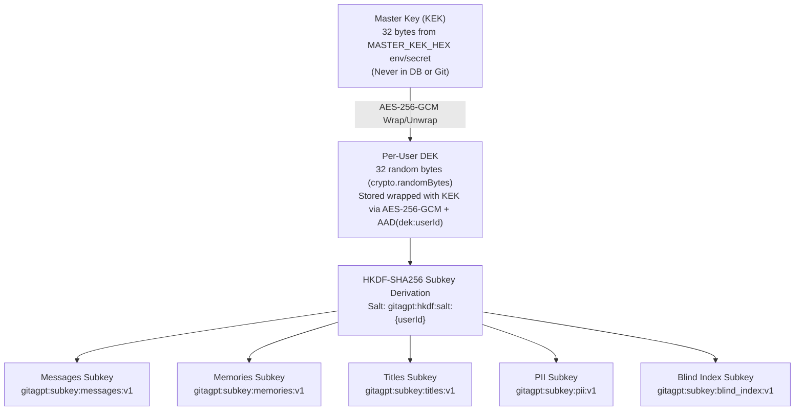

# GitaGPT Security, Encryption & Threat Model (`SECURITY.md`)

## 1. Honest Threat Model Disclosure (What Is Protected & What Is Not)

> **Important Disclosure — Not End-to-End Encrypted (E2EE):**
> GitaGPT uses **Defense-in-Depth Envelope Encryption at Rest (`AES-256-GCM` + `HKDF-SHA256` + `AAD`)** and **TLS 1.2+ in Transit**.
> It is **NOT end-to-end encrypted (E2EE)**, because the server must decrypt conversation context in volatile memory in order to construct the prompt and query the LLM.

### What This Architecture Protects Against
1. **Database Leaks & SQL Injection Dumps**: Every message (`encrypted_content`), memory (`encrypted_memory_text`), conversation title (`encrypted_title`), and user PII (`encrypted_email`, `encrypted_name`) is stored as `AES-256-GCM` ciphertext (`v{version}:{iv}:{ciphertext}:{authTag}`). A leaked PostgreSQL dump without the Master Key (`MASTER_KEK_HEX`) reveals zero plaintext.
2. **Stolen Disk Snapshots & Backups**: Daily `pg_dump` backups ([backup.sh](file:///c:/Users/ACER/Downloads/GitaGpt/backend/scripts/backup.sh)) contain only `AES-256-GCM` field ciphertexts and are additionally outer-encrypted with `AES-256-CBC` (`PBKDF2`, 100,000 iterations).
3. **Cross-User / Row-Swapping Tampering (AAD Binding)**: Every field encryption binds `Additional Authenticated Data (AAD)` to `${user_id}|${record_id}|${field_name}`. If an attacker or bug attempts to copy ciphertext from User A to User B, or swap a `title` ciphertext into `content`, GCM tag verification fails deterministically.
4. **Cross-Tenant Queries**: PostgreSQL **Row-Level Security (RLS)** policies ([001_init_schema.sql](file:///c:/Users/ACER/Downloads/GitaGpt/backend/db/migrations/001_init_schema.sql)) enforce `user_id = current_setting('app.current_user_id')::uuid` at the database engine layer alongside backend ownership checks.
5. **Stolen Refresh Tokens**: Refresh tokens are stored **only as SHA-256 hashes** (`token_hash`) with a `family_id`. If a rotated refresh token is replayed, reuse detection immediately revokes the entire token family for that user.

### What This Architecture Does NOT Protect Against
- **Compromised Server Operator / Live Root Memory Inspection**: Because the backend unwraps the user's DEK in memory during active requests to send context to the LLM, a malicious server operator with live root access to both the running process and `MASTER_KEK_HEX` could inspect active plaintext in RAM. This is stated transparently in our Privacy Policy.

---

## 2. Envelope Encryption Specification ([envelope.js](file:///c:/Users/ACER/Downloads/GitaGpt/backend/src/crypto/envelope.js))



- **Ciphertext Format**: `v{version}:{iv_base64}:{ciphertext_base64}:{authTag_base64}`
- **IV Generation**: Fresh 96-bit (`12-byte`) `crypto.randomBytes(12)` on every single encryption.
- **Key Rotation ([rotateKek.js](file:///c:/Users/ACER/Downloads/GitaGpt/backend/scripts/rotateKek.js))**: Rotating `MASTER_KEK_HEX` from `v1` to `v2` re-wraps all `users.wrapped_dek` values in a single transaction **without re-encrypting any message or memory rows**.

---

## 3. Searchable Encrypted Fields Trade-Off Analysis

We evaluated two approaches for searching encrypted conversations without decrypting all rows in SQL:
1. **Option A — Per-User `HMAC-SHA256` Blind Index (`computeSearchBlindIndex`)**: Computes truncated `HMAC-SHA256(subkey_blind_index, normalized_token)` tokens stored in a PostgreSQL `TEXT[]` column with a `GIN` index (`idx_messages_search_gin`).
   - *Pros*: Fast $O(\log N)$ server-side keyword lookup across thousands of historical messages without decrypting rows in SQL.
   - *Cons*: Leaks within-user word-frequency correlation if an attacker inspects the `TEXT[]` array for a single user.
2. **Option B — Client-Side Search Over Decrypted Recent Chats**: Decrypts the active user's recent conversation list and filters in client memory.
   - *Pros*: Zero keyword frequency leakage in the database.
   - *Cons*: Only searches loaded threads.

**Our Choice**: We use **Option B (Client-Side Search over decrypted recent threads)** as the primary instant search in the UI for maximum privacy and zero leakage, while providing **Option A (`computeSearchBlindIndex`)** on the backend using a dedicated per-user HKDF subkey (`KEY_PURPOSES.BLIND_INDEX`) for server-side historical search.

---

## 4. Self-Hosted Authentication & Google OAuth Setup

### Why a Minimal Native Crypto Auth Implementation (3-Line Justification)
1. Envelope encryption requires generating, wrapping, and unwrapping each user's 32-byte DEK atomically during user creation, token refresh, and account deletion.
2. Using Node's built-in `crypto` (`HS256` short-lived JWTs + SHA-256 hashed rotating refresh tokens with family reuse-detection) eliminates third-party auth supply-chain bloat.
3. It supports both Web (`httpOnly; Secure; SameSite=Strict` cookies) and Android (`Android Keystore` Secure Storage) from a single unified gateway with zero vendor lock-in.

### Creating Google OAuth Web & Android Client IDs (`SHA-1` / `SHA-256`)
1. Open the **Google Cloud Console → APIs & Services → Credentials**.
2. **Web Client ID**:
   - Click **Create Credentials → OAuth client ID → Web application**.
   - Add Authorized JavaScript origins: `http://localhost:5173` and your production HTTPS domain.
   - Copy the Client ID into `backend/.env` as `GOOGLE_WEB_CLIENT_ID`.
3. **Android Client ID**:
   - Click **Create Credentials → OAuth client ID → Android**.
   - Set Package name: `org.gitagpt.app`.
   - Obtain your signing keystore `SHA-1` and `SHA-256` fingerprints via:
     ```bash
     keytool -list -v -keystore your-release-key.jks -alias your-key-alias
     ```
   - Paste the `SHA-1` fingerprint into the Android OAuth client form and copy the resulting Client ID into `backend/.env` as `GOOGLE_ANDROID_CLIENT_ID`.
